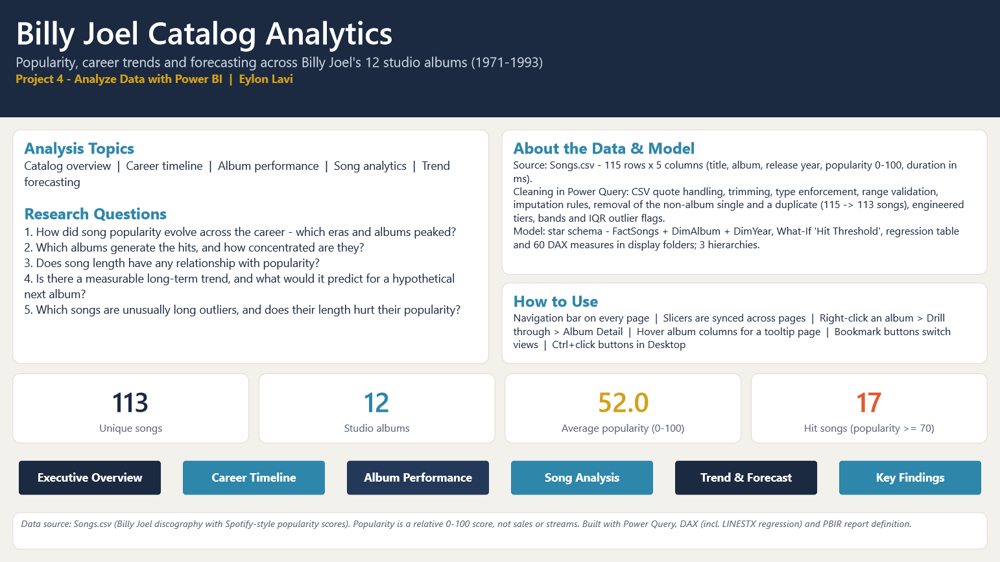
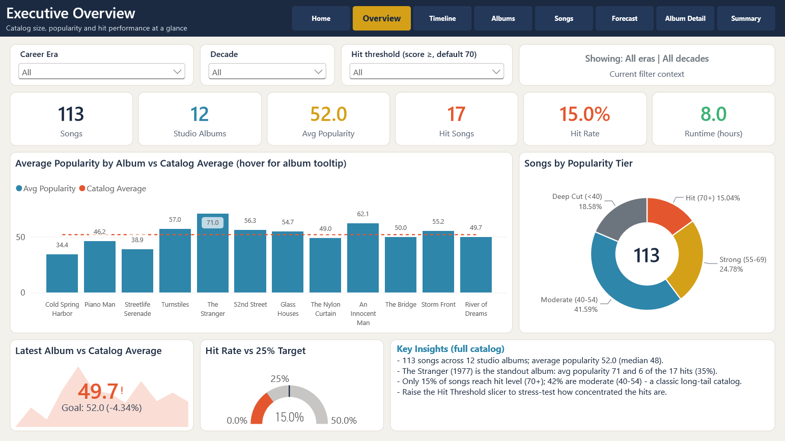
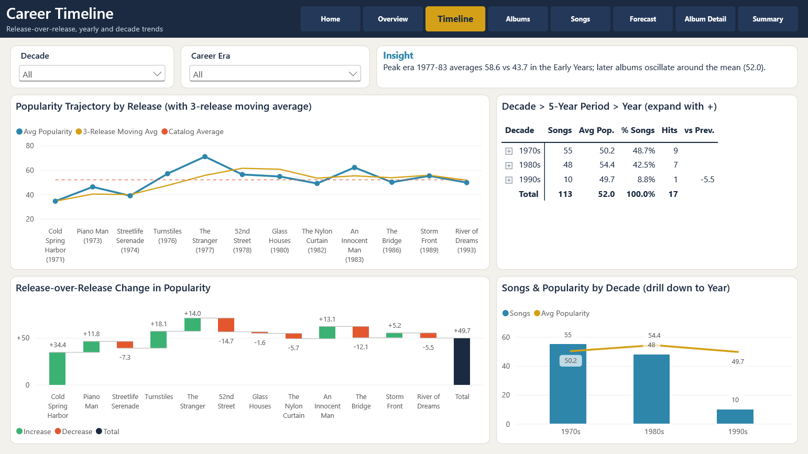
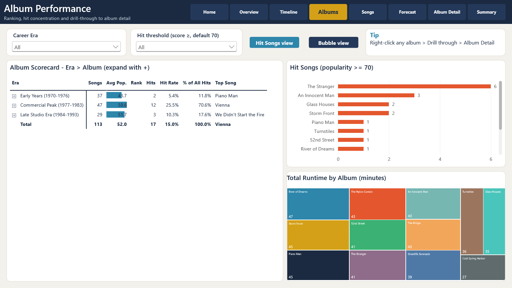
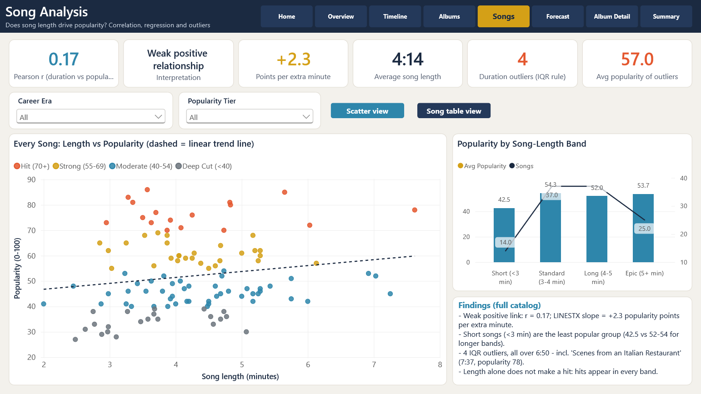
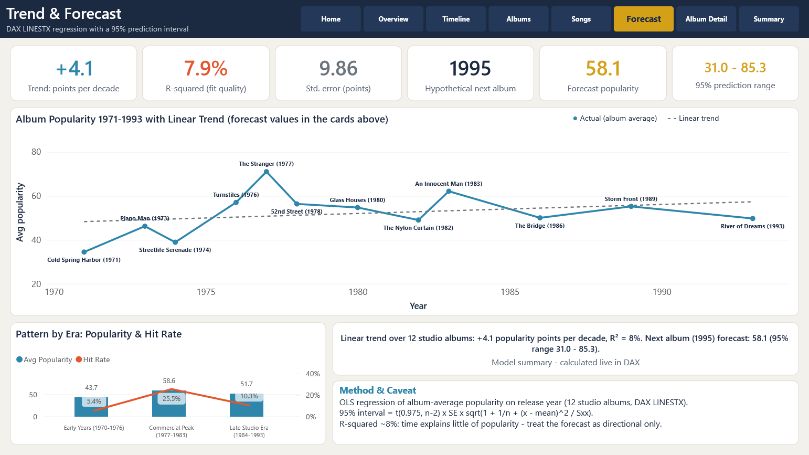
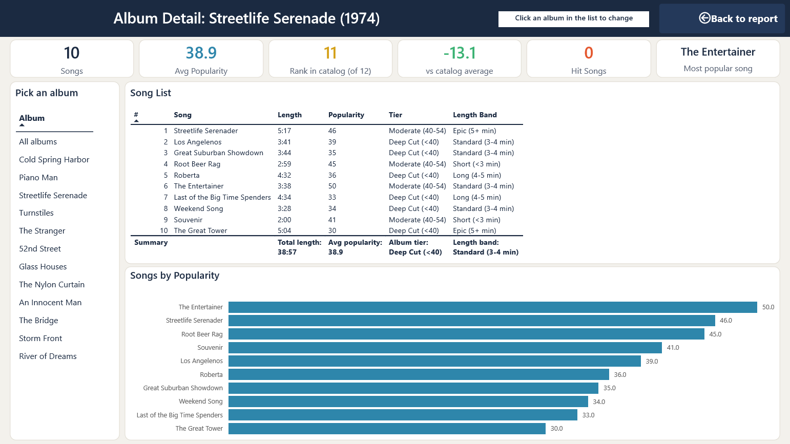
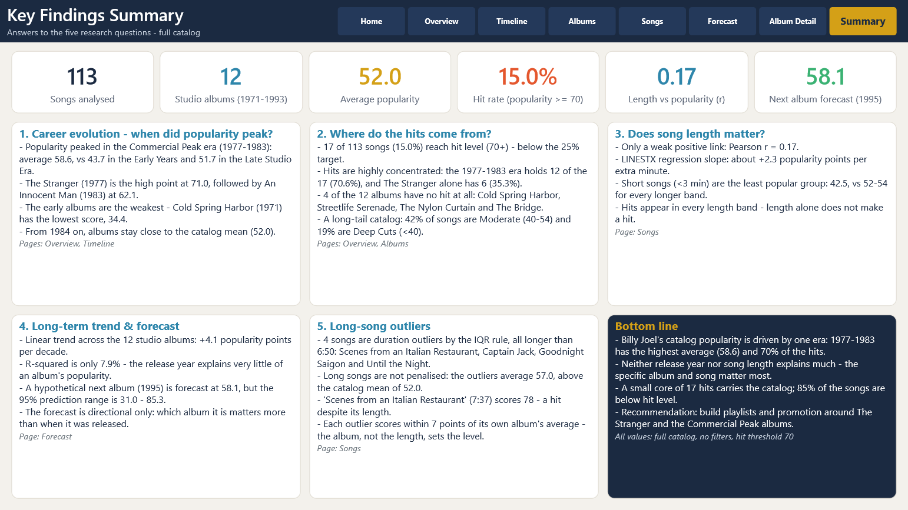

# 🎹 Billy Joel Song Catalog Analysis – Power BI

**Popularity, Career Trends and Forecast** · Eylon Lavi

> 📄 **[View full report (PDF)](Dashboard.pdf)** &nbsp;|&nbsp; ⬇️ **[Download .pbix](Dashboard.pbix)** *(opens in the free Power BI Desktop, Windows only)*

---

## 🎯 Analysis Topic
This project analyzes the song catalog of singer-songwriter Billy Joel: **12 studio albums released between 1971 and 1993**. A standalone 2024 single, not part of any album, was excluded.

The goal is to understand what characterizes successful songs and albums, how popularity changed over the course of his career, and whether a long-term trend can be identified and used for a forecast.

**Success metric:** a relative popularity score (0–100, Spotify-style), examined alongside song length, release year and album.

## 📁 Data Source
`Songs.csv` – 115 rows, 5 columns. After cleaning: **113 unique songs across 12 studio albums**.

| Column | Type | Description |
|--------|------|-------------|
| `song_title` | Text | Song title |
| `album_name` | Text | Album name (or "Single") |
| `release_year` | Whole number | Album release year |
| `popularity` | Whole number | Popularity score, 0–100 |
| `duration_ms` | Whole number | Song length in milliseconds |

## ❓ Research Questions
1. **Trends over time** – How did song popularity evolve across the career? Which eras and albums peaked?
2. **Album performance** – Which albums generate the hits, and how concentrated are the hits in a few albums?
3. **Song characteristics** – Does song length have any relationship with popularity?
4. **Forecast** – Is there a measurable long-term trend, and what would it predict for a hypothetical next album?
5. **Outliers** – Which songs are unusually long, and does their length hurt their popularity?

## 📈 Key Findings

**1. Career evolution – when did popularity peak?**
- Popularity peaked in the **Commercial Peak era (1977–1983)**: average 58.6, vs 43.7 in the Early Years and 51.7 in the Late Studio Era.
- **The Stranger (1977)** is the high point at 71.0, followed by An Innocent Man (1983) at 62.1.
- The early albums are the weakest: Cold Spring Harbor (1971) has the lowest score, 34.4.

**2. Where do the hits come from?**
- **17 of 113 songs (15.0%)** reach hit level (70+), below the 25% target.
- Hits are highly concentrated: the 1977–1983 era holds 12 of the 17 (70.6%), and The Stranger alone has 6.
- 4 of the 12 albums have no hit at all.

**3. Does song length matter?**
- Only a weak positive link: **Pearson r = 0.17** (about +2.3 popularity points per extra minute).
- Short songs (<3 min) are the least popular group: 42.5, vs 52–54 for every longer band.
- Hits appear in every length band; length alone does not make a hit.

**4. Long-term trend & forecast**
- Linear trend: **+4.1 popularity points per decade**, but R² is only 7.9%.
- A hypothetical next album (1995) is forecast at **58.1**, with a wide 95% prediction range of 31.0–85.3.
- The forecast is directional only: which album it is matters more than when it was released.

**5. Long-song outliers**
- 4 songs are duration outliers by the IQR rule (all longer than 6:50).
- Long songs are not penalised: the outliers average 57.0, above the catalog mean of 52.0.
- *Scenes from an Italian Restaurant* (7:37) scores 78, a hit despite its length.

### 💡 Bottom Line
Billy Joel's catalog popularity is driven by one era: **1977–1983 has the highest average and 70% of the hits**. Neither release year nor song length explains much; the specific album and song matter most.
**Recommendation:** build playlists and promotion around *The Stranger* and the Commercial Peak albums.

## 📑 Report Pages
| Page | Topic | Question |
|------|-------|:--------:|
| **Home** | Landing page: research questions, data & model description, navigation | — |
| **Overview** | Executive snapshot: catalog size, popularity, hit rate | 1, 2 |
| **Timeline** | Trends by release, year, 5-year period, decade and career era | 1 |
| **Albums** | Album ranking, hit concentration, album timeline bubble chart, drill-through | 2 |
| **Songs** | Correlation & regression between length and popularity, outliers | 3, 5 |
| **Forecast** | Linear regression (LINESTX) and forecast with a 95% prediction interval | 4 |
| **Album Detail** | Full album breakdown (select or drill through from any page) | 2 |
| **Summary** | One answer panel per research question, with supporting KPIs | 1–5 |

## 🛠️ Key Techniques
- **Power Query** – parameter, custom function, staging query, Merge, IQR outlier detection
- **Data Model** – star schema with 3 hierarchies
- **DAX** – 71 measures: Time Intelligence, RANKX, Pearson correlation, LINESTX regression, prediction interval
- **Interactivity** – What-If parameter, synced slicers, bookmarks, drill-through, tooltip page
- **Design** – custom theme

## 🖼️ Screenshots

### Overview

### Timeline

### Albums

### Songs

### Forecast

### Album Detail

### Summary

---

**👤 Eylon Lavi** · [Email](mailto:eylonlavi105@gmail.com)
